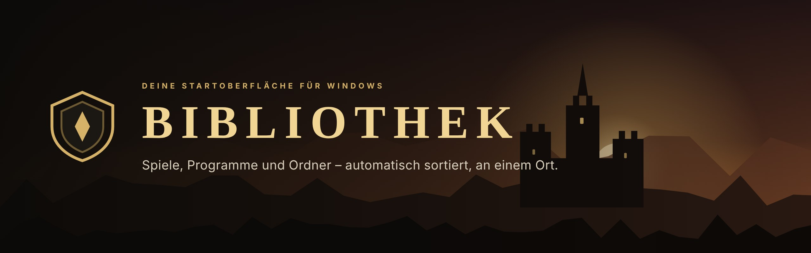
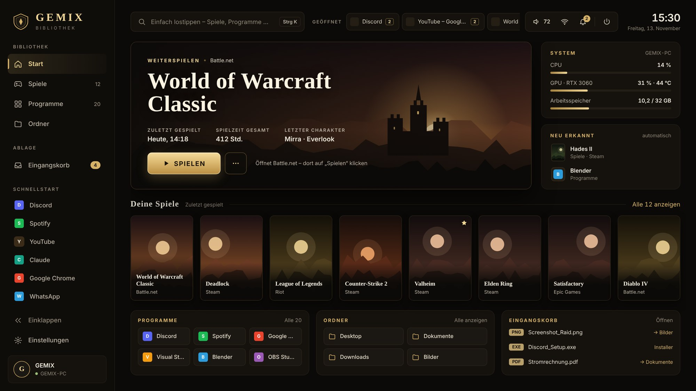
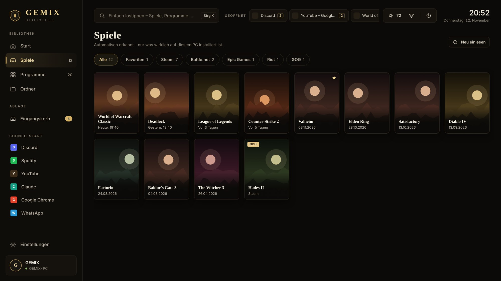
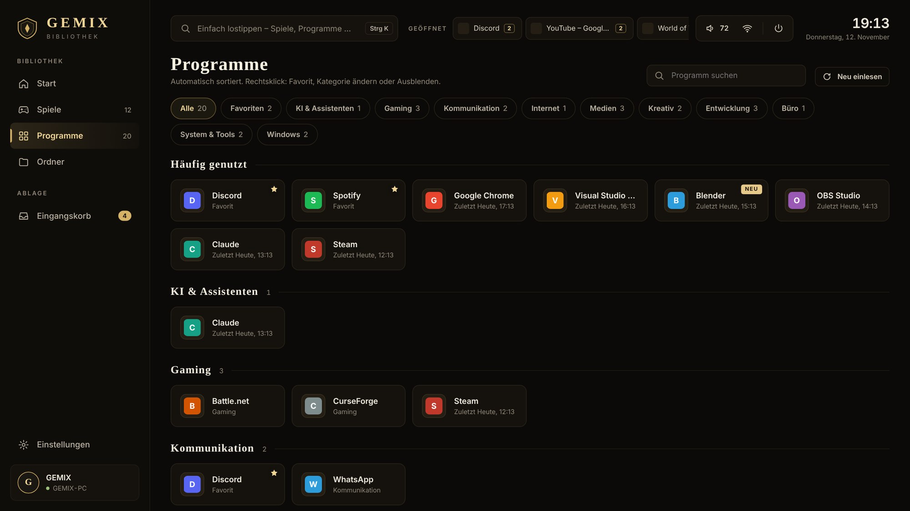
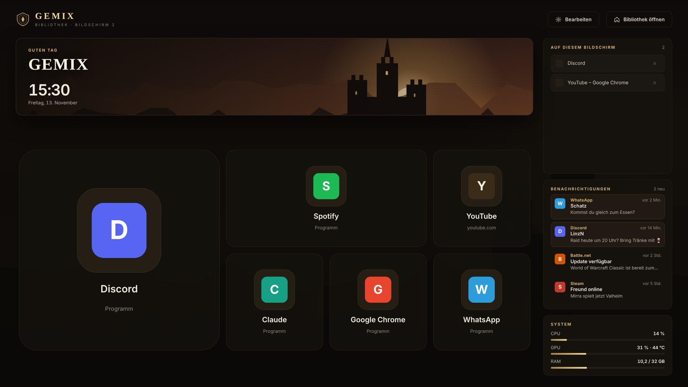
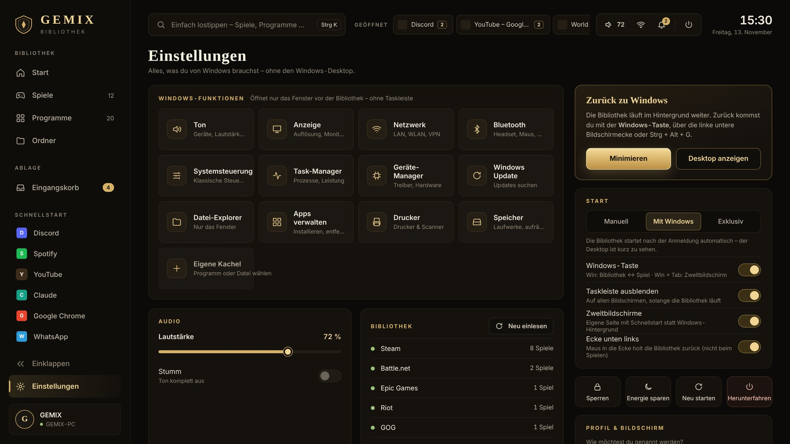
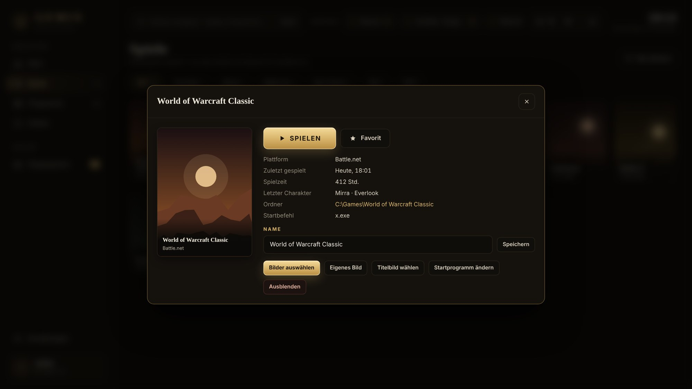
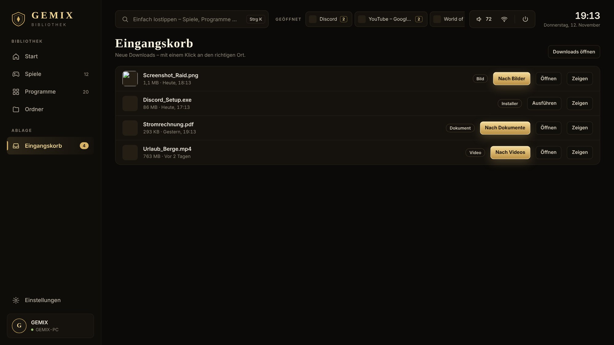

<p align="center">
  
</p>

<p align="center">
  
  
  
  
</p>

<p align="center">
  <b>Kein Windows-Desktop mehr. Kein Chaos aus Verknüpfungen.</b><br>
  Die Bibliothek ersetzt den Desktop durch eine Oberfläche wie Steam Big Picture – nur für deinen ganzen PC:<br>
  Spiele aus allen Launchern, Programme, Ordner und Downloads, automatisch erkannt und sortiert.
</p>

<p align="center">
  <a href="#-installation">Installation</a> ·
  <a href="#-funktionen">Funktionen</a> ·
  <a href="#-bedienung">Bedienung</a> ·
  <a href="#-galerie">Galerie</a> ·
  <a href="#-hilfe">Hilfe</a>
</p>

<br>

<p align="center">
  
</p>

---

## ✦ Funktionen

<table>
<tr>
<td width="50%" valign="top">

### 🎮 Alle Spiele an einem Ort
Steam, Battle.net, Epic Games, Riot und GOG werden **automatisch erkannt** – nur was wirklich installiert ist. Neue Spiele erscheinen von selbst.

- Offizielle Cover für Steam, für alle anderen über **SteamGridDB**
- **Bilder selbst auswählen** – Cover und Titelbild per Klick
- **Spielzeit** wird für jedes Spiel erfasst, egal wie es gestartet wurde
- World of Warcraft: zuletzt gespielter **Charakter und Realm**
- Läuft ein Spiel schon, springt „Zum Spiel“ direkt hinein

</td>
<td width="50%" valign="top">

### 🗂️ Programme, sauber sortiert
Alles aus dem Startmenü – auch Store-Apps – in **Kategorien**: Gaming, Kommunikation, Internet, Medien, Kreativ, Entwicklung, Büro, System & Tools.

- **Häufig genutzt** immer oben
- Scharfe Icons in hoher Auflösung
- Favoriten, Ausblenden, Kategorie und **Icon ändern** per Rechtsklick
- Suche: einfach lostippen

</td>
</tr>
<tr>
<td width="50%" valign="top">

### 🖥️ Mehrere Bildschirme
Auf jedem Zweitbildschirm eine eigene Seite statt Windows-Hintergrund: Begrüßung, Uhr, **Schnellstart** für Websites und Apps und die Fenster, die dort offen sind.

- Kacheln passen ihre Größe automatisch an
- **Bearbeiten-Modus**: Größe, Reihenfolge, eigene Icons, Bereiche
- Websites öffnen als neuer Tab im vorhandenen Browser
- Programme landen direkt auf dem richtigen Monitor

</td>
<td width="50%" valign="top">

### ⚙️ Windows – ohne Windows-Optik
Ton, Anzeige, Netzwerk, Bluetooth, Systemsteuerung, Task-Manager & Co. als Kacheln – es öffnet sich **nur das jeweilige Fenster**.

- Taskleiste weg, Fenster nutzen den **ganzen Bildschirm**
- Lautstärke direkt in der Bibliothek
- Eigene Kacheln für beliebige Programme
- Startmodi bis hin zu **Exklusiv**: nach der PIN direkt die Bibliothek

</td>
</tr>
</table>

**Außerdem:** Eingangskorb, der neue Downloads mit einem Klick einsortiert · eigene Dateiansicht für deine Ordner · Leiste mit allen offenen Fenstern als Taskleisten-Ersatz · System-Anzeige für CPU, GPU und RAM · Steuerung mit Maus, Tastatur oder Controller · persönliche Begrüßung mit deinem Namen.

---

## ⬇ Installation

**Voraussetzungen:** Windows 10 oder 11 · [Node.js (LTS)](https://nodejs.org) · [Git](https://git-scm.com/download/win) (empfohlen, für automatische Updates)

```bat
git clone https://github.com/IGemiXI/bibliothek.git C:\Bibliothek
```

Danach in `C:\Bibliothek` die Datei **`START.bat`** doppelklicken. Beim ersten Start richtet sich die Bibliothek ein (ca. 1–2 Minuten) und fragt, wie du genannt werden möchtest – oben steht dann z. B. **GEMIX Bibliothek**.

> **Updates kommen automatisch:** Bei jedem Start über `START.bat` holt sich die Bibliothek die neueste Version. Alternativ: *Einstellungen → Nach Updates suchen*.

<details>
<summary><b>Ohne Git installieren</b></summary>
<br>

Oben auf **Code → Download ZIP** klicken, an einen festen Ort entpacken (z. B. `C:\Bibliothek`) und `START.bat` starten. Updates musst du in diesem Fall selbst neu herunterladen.

</details>

> **Wichtig:** Den Ordner nach der Einrichtung nicht mehr verschieben – sonst findet der Autostart die Bibliothek nicht.

---

## ⌨ Bedienung

| Was | Wie |
|---|---|
| Bibliothek ↔ Spiel / letztes Fenster | <kbd>Win</kbd> |
| Zweitbildschirm-Seite nach vorne / wieder nach hinten (bleibt stehen, auch wenn du ins Spiel klickst) | <kbd>Win</kbd> + <kbd>Tab</kbd> |
| Suchen | einfach lostippen · <kbd>Strg</kbd> + <kbd>K</kbd> |
| Bibliothek nach vorne holen | <kbd>Strg</kbd> + <kbd>Alt</kbd> + <kbd>G</kbd> · Maus in die linke untere Ecke |
| Zwischen offenen Fenstern wechseln | Leiste „Geöffnet“ oben · <kbd>Alt</kbd> + <kbd>Tab</kbd> |
| Navigieren | Pfeiltasten · <kbd>Enter</kbd> · <kbd>Esc</kbd> |
| Controller | **A** öffnen · **B** zurück · **Y** Suche · **LB / RB** Bereich wechseln |

Windows-Kombinationen wie <kbd>Win</kbd> + <kbd>Shift</kbd> + <kbd>S</kbd> oder <kbd>Win</kbd> + <kbd>E</kbd> funktionieren weiterhin. Die Windows-Tasten-Funktionen lassen sich in den Einstellungen abschalten.

### Startmodi

| Modus | Verhalten |
|---|---|
| **Manuell** | Start nur über `START.bat` |
| **Mit Windows** | startet nach der Anmeldung automatisch – der Desktop ist kurz zu sehen |
| **Exklusiv** | nach der PIN kommt direkt die Bibliothek, kein Windows-Desktop |

### Cover für alle Spiele

Steam-Spiele bringen ihre Cover mit. Für Battle.net, Riot, Epic und GOG nutzt die Bibliothek **[SteamGridDB](https://www.steamgriddb.com)** – eine Community-Sammlung von Spielbildern für *alle* Launcher (nicht nur Steam).

1. [steamgriddb.com/profile/preferences/api](https://www.steamgriddb.com/profile/preferences/api) öffnen und oben rechts **mit Steam anmelden**
2. **Generate API Key** klicken und den Schlüssel kopieren
3. In der Bibliothek unter *Einstellungen → Bibliothek → Cover für alle Spiele* einfügen und speichern

Automatisch wird jeweils das bestbewertete Bild genommen. Über **„Bilder auswählen“** (Spiel anklicken oder Rechtsklick) suchst du dir Cover und Titelbild selbst aus – deine Auswahl bleibt dauerhaft.

---

## ▣ Galerie

<table>
<tr>
<td width="50%"><p align="center"><b>Spiele</b> – alle Launcher, gefiltert nach Plattform</p></td>
<td width="50%"><p align="center"><b>Programme</b> – automatisch in Kategorien</p></td>
</tr>
<tr>
<td width="50%"><p align="center"><b>Zweitbildschirm</b> – Schnellstart & offene Fenster</p></td>
<td width="50%"><p align="center"><b>Einstellungen</b> – Windows-Funktionen ohne Windows-Optik</p></td>
</tr>
<tr>
<td width="50%"><p align="center"><b>Spiel-Details</b> – Spielzeit, Charakter, Bilder, Startbefehl</p></td>
<td width="50%"><p align="center"><b>Eingangskorb</b> – Downloads mit einem Klick einsortiert</p></td>
</tr>
</table>

<sub>Screenshots mit Beispieldaten. Die Cover-Platzhalter werden in der App durch echte Cover ersetzt.</sub>

---

## ? Hilfe

<details>
<summary><b>„electron.exe konnte nicht gefunden werden“</b></summary>
<br>

`START.bat` lädt Electron in diesem Fall automatisch direkt von GitHub nach. Klappt das nicht, prüfe unter *Windows-Sicherheit → Viren- & Bedrohungsschutz → Schutzverlauf*, ob `electron.exe` entfernt wurde, und nimm den Ordner `C:\Bibliothek` als Ausnahme auf.

</details>

<details>
<summary><b>Die Windows-Taste wechselt nicht aus einem Spiel heraus</b></summary>
<br>

- Läuft das Spiel oder sein Launcher **als Administrator**, darf Windows normalen Programmen keine Tastendrücke melden. „Als Administrator ausführen“ in den Eigenschaften der Verknüpfung abschalten.
- Im Spiel den Anzeigemodus **„Fenster (Vollbild)“** statt „Vollbild“ wählen – sieht gleich aus, Wechsel gehen sofort.

</details>

<details>
<summary><b>Exklusiv-Modus: schwarzer Bildschirm</b></summary>
<br>

<kbd>Strg</kbd> + <kbd>Alt</kbd> + <kbd>Entf</kbd> → Task-Manager → „Neuen Task ausführen“ → `explorer` eingeben. Danach in der Bibliothek unter *Einstellungen → Start* wieder „Mit Windows“ oder „Manuell“ wählen und neu anmelden.

</details>

<details>
<summary><b>Taskleiste bleibt nach einem Absturz auf „automatisch ausblenden“</b></summary>
<br>

Die Bibliothek stellt die ursprüngliche Einstellung beim nächsten Beenden wieder her. Von Hand: Rechtsklick auf die Taskleiste → *Taskleisteneinstellungen → Verhalten der Taskleiste*.

</details>

<details>
<summary><b>Wo liegen meine Daten?</b></summary>
<br>

Alle persönlichen Einstellungen, Spielzeiten und Bilder liegen lokal in `%APPDATA%\Bibliothek\` und werden **nirgendwo hochgeladen**. Ordner löschen = Neustart wie beim ersten Mal.

</details>

---

## ⚒ Technik

Die Bibliothek ist eine [Electron](https://www.electronjs.org)-App (HTML, CSS, JavaScript) ohne weitere Abhängigkeiten. Windows-Funktionen wie Lautstärke, Fensterverwaltung, Taskleiste und die Windows-Taste übernimmt ein kleiner PowerShell-Helfer mit eingebettetem C#.

```
src/
├─ main.js          Hauptprozess: Fenster, Erkennung, Spielzeit, Startmodi
├─ helper.ps1       Windows-Helfer (Audio, Fenster, Taskleiste, Icons, Windows-Taste)
├─ lib/             Spiele- und Programmerkennung, Cover-Suche
└─ renderer/        Oberfläche (Startseite, Zweitbildschirm, Einstellungen)
```

Änderungen und Versionen: siehe [CHANGELOG](CHANGELOG.md).

<br>

<p align="center"><sub>Gebaut von <b>GEMIX</b> im WoW-Forever-Stil · Nicht verbunden mit Blizzard, Valve, Epic, Riot oder GOG.</sub></p>
